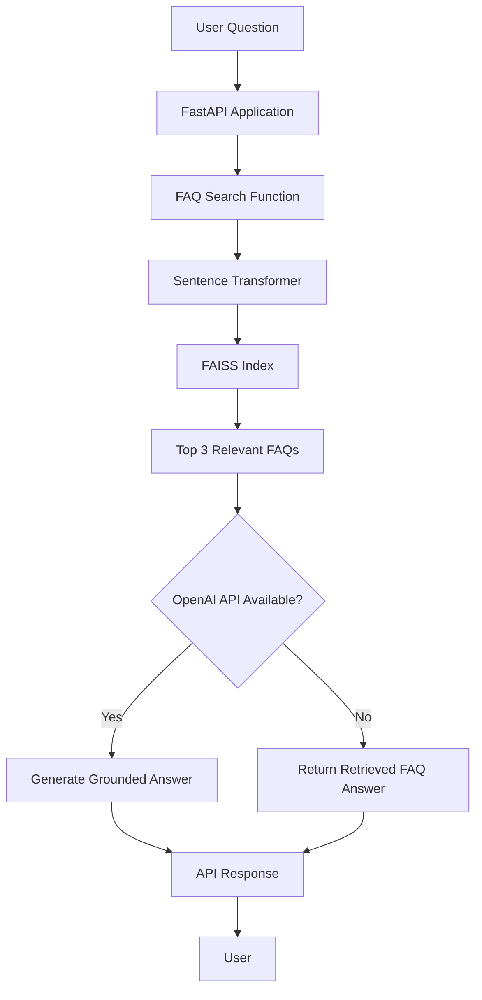

# GreenField Farmers FAQ Search API
## Project Handover Document

### 1. Project Overview

GreenField Farmers FAQ Search is an AI-powered FAQ search application that retrieves relevant answers to user questions using semantic search.

The system uses FAISS and Sentence Transformers to find relevant FAQ entries. A FastAPI endpoint returns answers using the retrieved FAQ content, with optional OpenAI integration for generating grounded responses.

### 2. Technology Stack

- **Programming Language:** Python
- **API Framework:** FastAPI
- **Semantic Search:** FAISS
- **Embedding Model:** `sentence-transformers/all-MiniLM-L6-v2`
- **AI Integration:** OpenAI API (optional)
- **Containerization:** Docker
- **Testing:** Pytest
- **Deployment Target:** Railway
- **CI/CD Target:** GitHub Actions
- **Container Registry:** Docker Hub

### 3. Project Architecture



### 4. Main Project Files

| File / Folder | Purpose |
|---|---|
| `faq.json` | Contains FAQ questions and answers |
| `build_index.py` | Generates the FAISS search index |
| `faiss_index.index` | Stores the generated FAISS index |
| `search_faq.py` | Performs semantic FAQ searches |
| `test_search_faq.py` | Tests FAQ search functionality |
| `app/main.py` | Implements the FastAPI application |
| `requirements.txt` | Lists Python dependencies |
| `Dockerfile` | Defines the Docker image configuration |
| `.dockerignore` | Excludes unnecessary files from Docker builds |
| `.github/workflows/deploy.yml` | Intended GitHub Actions deployment workflow |
| `README.md` | Project documentation |
| `Handover.md` | Project handover information |

### 5. API Usage

**Base URL:** Provided by the deployment platform after successful deployment.

**Health Check**

- Method: `GET`
- Endpoint: `/`

Example response:

```json
{
  "message": "GreenField Farmers FAQ API is running"
}
```

**Ask a Question**

- Method: `POST`
- Endpoint: `/answer`
- Content-Type: `application/json`

Example request:

```json
{
  "question": "How can I become a member?"
}
```

Example response:

```json
{
  "answer": "Membership information is available from the co-op.",
  "sources": ["1", "2", "3"]
}
```

The example answer and source IDs are illustrative; actual results depend on the FAQ dataset.

### 6. Search and Answer Logic

1. The application receives a question.
2. The question is converted into an embedding using the Sentence Transformer model.
3. FAISS searches for the three most relevant FAQ entries.
4. Similarity scores are used to determine whether the retrieved results are sufficiently relevant.
5. If the highest similarity score is below `0.45`, the API returns the fallback response.
6. If OpenAI is configured, the retrieved FAQ entries are supplied as context to generate a grounded answer.
7. Without an OpenAI API key, the application returns the highest-ranked FAQ answer.

**Fallback response:**

`We’ll get back to you shortly`

The fallback is also returned when no suitable search result is found or the submitted question is empty.

### 7. Environment Variables and Credentials

The following environment variables may be required:

| Variable | Purpose |
|---|---|
| `OPENAI_API_KEY` | OpenAI API authentication |
| `OPENAI_MODEL` | OpenAI model selection; defaults to `gpt-4o-mini` |
| `PORT` | Application port; defaults to `8000` in the Docker command |

For deployment, configure the necessary credentials securely in the relevant platform settings.

Required deployment credentials include:

- Docker Hub username and access token.
- Railway deployment credentials.
- OpenAI API key, if using OpenAI-generated answers.

**Security:** Never commit actual API keys, passwords, access tokens, or `.env` files to GitHub. Use GitHub Actions secrets and Railway environment variables where appropriate.

### 8. Local Setup and Execution

**Prerequisites**

- Python 3.11 or compatible Python environment.
- Git.
- Required Python packages from `requirements.txt`.

**Install dependencies**

```bash
python -m pip install -r requirements.txt
```

**Run the API**

```bash
python -m uvicorn app.main:app --reload
```

**Access API documentation**

```text
http://127.0.0.1:8000/docs
```

If the FAISS index is missing or needs updating, generate it using:

```bash
python build_index.py
```

### 9. Docker Configuration

The project includes:

- `Dockerfile` for building the application image.
- `.dockerignore` for excluding unnecessary development files.

The Docker configuration uses Python 3.11 slim and runs the FastAPI application through Uvicorn on the configured port.

The local Docker build and container execution have not yet been confirmed.

### 10. Testing and Verification

The following search test was successfully executed:

```bash
python -m pytest -v
```

**Recorded result:**

```text
collected 1 item

test_search_faq.py::test_membership_query_returns_expected_faq_first PASSED

1 passed in 37.37s
```

This confirms that the membership query returned the expected FAQ as the first search result.

The complete API test suite, deployment workflow, and production deployment must be verified separately.

### 11. Deployment Status

| Component | Status |
|---|---|
| FAQ dataset | Created |
| FAISS index | Created |
| Semantic search | Tested successfully |
| FastAPI application | Implemented and previously tested |
| Dockerfile | Created |
| `.dockerignore` | Created |
| GitHub Actions workflow | Requires final configuration and verification |
| Docker Hub image | Pending verification |
| Railway deployment | Pending verification |
| Live API URL | Pending verification |

### 12. Recommended Next Steps

1. Complete and verify `.github/workflows/deploy.yml`.
2. Configure Docker Hub credentials securely.
3. Configure Railway and its required environment variables.
4. Push the project changes to the GitHub repository.
5. Verify that GitHub Actions successfully builds and pushes the Docker image.
6. Deploy the application to Railway.
7. Test the live `/` and `/answer` endpoints.
8. Update the README with the verified repository and live API URLs.

### 13. Important Notes for the Next Developer

- Keep `faq.json` and `faiss_index.index` synchronized. Rebuild the index whenever the FAQ questions change.
- The current source IDs are generated from the FAQ entries' positions in `faq.json`; they are not permanent IDs stored in the dataset.
- The embedding model may need to be downloaded when the application starts in a new environment.
- Keep the OpenAI integration optional and ensure the fallback behavior continues to work without an API key.
- Never expose deployment credentials in source code or documentation.
- Verify the deployed application before marking the project as complete.

---

**Project:** GreenField Farmers FAQ Search API  
**Handover:** Technical implementation, configuration, testing, and deployment guidance  
**Status:** Core search implementation tested; final deployment verification pending.